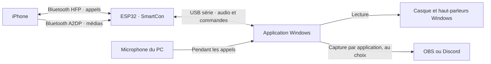

<div align="center">

# SmartCon

**Les appels et le son de l’iPhone dans le casque du PC.**

Un pont Bluetooth vers USB qui relie l’iPhone à un casque et à un microphone Windows,
avec une application de bureau pour les appels, les médias et le contrôle des téléphones.

</div>

## Ce que fait SmartCon

- **Appels mains libres** : l’audio HFP passe entre l’iPhone et le casque du PC, micro compris.
- **Musique et vidéo** : l’audio stéréo A2DP de l’iPhone est envoyé au PC.
- **Gestion des téléphones** : appairage avec comparaison d’un code, sélection d’un téléphone autorisé, déconnexion et oubli.
- **Audio Windows** : écoute sur le périphérique choisi, capture SmartCon comme source distincte dans OBS, et atténuation Windows pendant les communications.
- **Aucun câble audio virtuel** : l’ESP32 transporte l’audio sur USB série ; Windows continue de lire les autres applications normalement.

## Comment ça marche



Le firmware garde les médias SBC compressés sur le lien série. L’application Windows
les décode puis lit le son à 48 kHz. Le micro du PC n’est envoyé au téléphone que
pendant un appel. Le firmware et l’application échangent aussi l’état et les
commandes de gestion des téléphones.

## Démarrage rapide

### Utiliser l’application Windows

1. Récupérer l’exécutable `SmartCon.exe` depuis une livraison du projet ou le
   [compiler](pc/README.md#application-windows-avec-icone-pres-de-lhorloge).
2. Brancher la carte ESP32 au PC en USB et fermer les autres programmes qui utilisent
   son port série.
3. Lancer SmartCon, choisir le port COM, le casque et le microphone, puis démarrer le pont.
4. Dans **Téléphones**, ouvrir l’appairage, sélectionner SmartCon sur l’iPhone et
   comparer puis approuver le code affiché.
5. Choisir SmartCon comme sortie Bluetooth de l’iPhone pour écouter les appels ou les médias.

Le guide [application Windows, OBS, Discord et atténuation](pc/README.md) décrit les
réglages et les limites de capture. L’application peut rester dans la zone de
notification ; utiliser **Quitter** pour libérer le port série avant un flash.

### Compiler et flasher le firmware

Depuis un terminal initialisé avec ESP-IDF 6.1, à la racine du dépôt :

```powershell
idf.py -B build_audio_pc -p COM3 build flash
```

Remplacer `COM3` par le port de la carte. Cette commande construit le firmware pour
la cible ESP32 configurée puis le flashe. Voir le [guide du firmware](main/README.md)
pour les prérequis, l’architecture et les points d’entrée du code.

### Construire l’application Windows

Depuis PowerShell à la racine du dépôt :

```powershell
powershell -ExecutionPolicy Bypass -File .\pc\build_windows.ps1
```

L’exécutable est produit dans `dist\SmartCon\SmartCon.exe`. Le guide PC donne aussi
les instructions pour lancer l’application depuis les sources.

## Documentation

| Sujet | Guide |
| --- | --- |
| Application, périphériques, OBS, Discord et communications Windows | [Guide utilisateur PC](pc/README.md) |
| Build, flash et architecture du code ESP32 | [Guide firmware](main/README.md) |
| Architecture WASAPI et maintenance du son Windows | [Guide technique audio](pc/WINDOWS_AUDIO.md) |
| Résultats de validation et essais matériels restants | [Validation audio](pc/VALIDATION_AUDIO.md) |
| Historique détaillé, décisions et état du projet | [Dossier de projet](ETAT_DU_PROJET.md) |

## État du projet

SmartCon est un projet en évolution. Les essais dépendent du téléphone, du casque,
de la carte ESP32 et de la version de Windows. Consultez le dossier de projet et
les notes de validation avant de considérer un scénario matériel comme validé.

## Licence

Aucune licence de redistribution n’est déclarée dans ce dépôt pour le moment.
